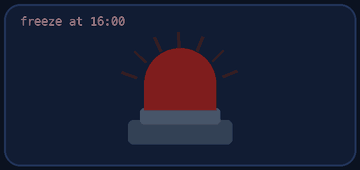
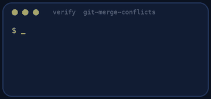
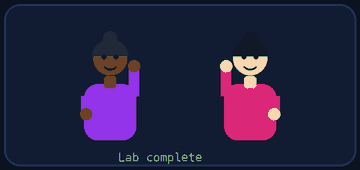

<p align="center"></p>

| | |
|-|-|
| **Time** | 40-50 min |
| **Cost** | free |
| **You need** | Git in your Ubuntu environment |

## How this lab works

1. **Fork** this repository to your own GitHub account (button at the top right).
2. Clone **your fork** in your Ubuntu environment (WSL on Windows, your OrbStack machine on Mac).
3. Read the lab below (the same text is in [`LAB.md`](LAB.md)) and follow the mission.
4. Answer the questions in [`SUBMISSION.md`](SUBMISSION.md). Where a question asks for output, paste it in a code block. No screenshots needed.
5. Commit and push. Open the **Actions** tab of your fork (click *I understand my workflows, go ahead and enable them* the first time). The **Lab check** shows what is still missing.
6. When the check is green, **submit the URL of your fork** in the course platform.

> [!NOTE]
> The check only looks at your answers and any files the lab asks you to commit. Your instructor reads your work and may ask you to explain any line.

<p align="center"></p>

## 🎬 The situation

<p align="center"></p>

Friday, 15:00. The release freezes at 16:00. Three developers have three finished branches and every one of them touched `config.yaml`. Priya added custom aliases, Tomas added rate limiting and Maya made the container run as a non-root user. Nobody wants to merge first because everybody remembers last month.

You are the one who merges. Nobody's work may disappear, and `main` must still build.

> [!IMPORTANT]
> **Your mission**
> - Read each branch to understand what its author wanted
> - Merge all three into `main` and resolve every conflict **on purpose**
> - Make sure the merged result is correct, not merely conflict-free

**Time:** 40-50 min | **Cost:** free | **You need:** Git in your Ubuntu environment

<p align="center"></p>

## Part 0 - Set the scene

Fork this repository, clone your fork, and run:

```bash
./setup.sh
```

You get a repository in `sandbox/clipstr` with `main` and three branches. Work inside `sandbox/clipstr`.

<p align="center"></p>

## Part 1 - Recon: what does each branch want?

<p align="center"></p>

For each of the three branches, run:

```bash
git log --oneline main..feature/aliases
git diff main...feature/aliases
```

(and the same for `ratelimit` and `container`). Note which **files and lines** each branch changes. Draw a small table: file, branch A, branch B, branch C.

> [!NOTE]
> **Predict** Before merging anything: which files do you expect to conflict, and between which branches? Which will **not** conflict even though two branches changed them?

<p align="center"></p>

## Part 2 - Merge, one at a time

Merge `feature/aliases` first, then `feature/ratelimit`, then `feature/container`, each with `git merge`. For every merge that stops with a conflict:

1. `git status` shows which files are in conflict. `git diff` shows the markers.
2. Open the file and read **both sides**. Decide what the file should say once both features are present. Edit it by hand. Do not just pick a side.
3. Check there are no `<<<<<<<`, `=======` or `>>>>>>>` lines left (`git grep -n '<<<<<<<'`).
4. `git add` the file, then `git commit` to finish the merge.

> [!WARNING]
> **Break it** Before you resolve the **second** merge, try the shortcut on one file: `git checkout --theirs config.yaml`. Look at what is left in the file. Which feature just disappeared? Undo it with `git merge --abort` and start that merge again. (Abort throws away the half-finished merge safely, learn that command now.)

> [!NOTE]
> **Think** Some conflicts are *textual* (the same line) and some are *semantic* (Git merges cleanly and the result is still wrong, for example two branches both add a `pip install` line). Which did you meet here?

Pay attention to these three, they are the classic traps:

- `requirements.txt`: both sides appended a line. Both lines must survive, and each package must appear once.
- `app.py`: two branches changed the same function signature. The final signature must support both features.
- `Dockerfile`: two branches changed the same `RUN` line differently. Combine them into **one** command.

<p align="center"></p>

## Part 3 - Make sure it still works

A clean merge is not a correct merge. Review the final files:

```bash
git diff main~3 main -- config.yaml Dockerfile requirements.txt app.py
python3 -m py_compile app.py
```

Read the final `Dockerfile` as if you were about to build it. Does the order of lines make sense (user created before it is used)? Does the port in `config.yaml` match the port in the Dockerfile?

<p align="center"></p>

## Part 4 - Prove it

<p align="center"></p>

```bash
./verify.sh
```

It checks that all three branches are merged, that no markers remain and that **every author's change survived**.

<p align="center"></p>

## Level up (optional)

- **Order matters.** Run `./setup.sh` again and merge in the opposite order. Which conflicts changed?
- **rerere.** Enable `git config rerere.enabled true`, resolve a conflict, abort, and redo the merge. What did Git remember?
- **Visual tools.** Run `git mergetool` or open the conflicted file in VS Code's merge editor. Compare it with editing markers by hand.

<!-- teardown:start (generated by labs.py, do not edit) -->
## Tear down (mandatory)

<p align="center"></p>

Resources left behind cost money, keep doors open and pollute the next lab. Removing what you created is part of the job, so it is part of the submission: **you must prove it is gone**.

Do this **last**, after you have pasted your `verify` output into `SUBMISSION.md` (once you tear down, the lab can no longer be verified).

1. Run `./teardown.sh`. It deletes the `sandbox/` repository.

Then run the proof:

```bash
./verify-teardown.sh
```

It prints a list of checks and must end with **TEARDOWN VERIFIED**. If it reports leftovers, remove them and run it again. Paste the full output in your submission.
<!-- teardown:end -->

<!-- submission:start (generated by labs.py, do not edit) -->
## 📬 Submission

<p align="center"></p>

Answer the questions in `SUBMISSION.md` in **your fork** (paste output in code blocks where asked), push, then submit the **URL of your fork**.

**Questions to answer**

1. Pick one conflict. Paste the conflict markers as Git left them, then the resolved lines, and explain what each side was trying to do.
2. Why is `git checkout --ours file` (or `--theirs`) usually the wrong way to resolve a conflict in `config.yaml`? Which of the three conflicts would it have silently broken?
3. What does `git merge --abort` do, and when did you use it (or when would you)?
4. Why did the order in which you merged the three branches change which conflicts you saw? What could the team do to see fewer conflicts?
5. Paste the output of `./verify.sh`. It must end with **ALL CHECKS PASSED**.
6. **Tear down.** Paste the output of `./verify-teardown.sh`. It must end with **TEARDOWN VERIFIED**.
<!-- submission:end -->
